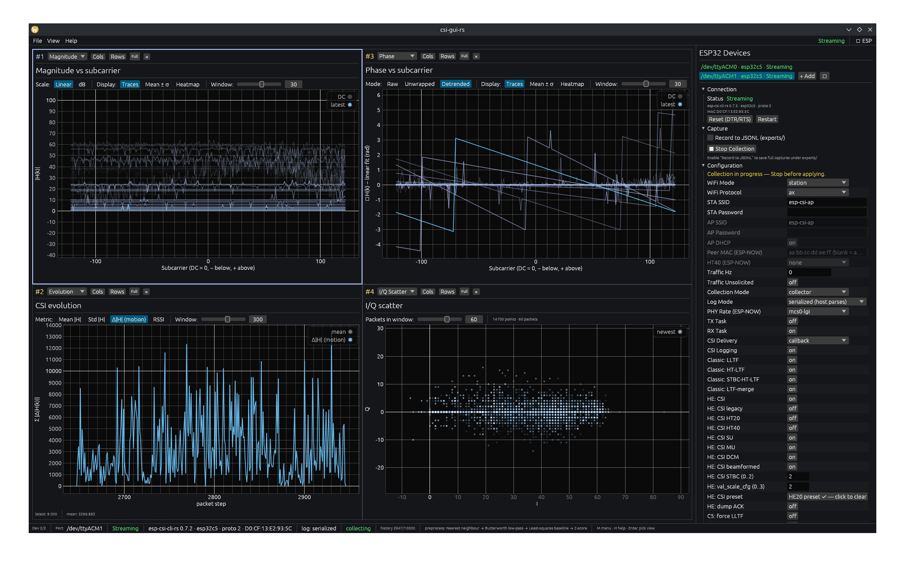

# csi-gui-rs

**A high-resolution desktop GUI for live ESP32 Wi-Fi Channel-State-Information (CSI) capture and analysis.**



Plug an ESP32 running [`esp-csi-cli-rs`](https://github.com/connectedmotion-io/esp-csi-cli-rs) into your laptop, run `csi-gui-rs`, and watch the radio channel in real time — magnitude, phase, I/Q scatter, channel impulse response, a phase-Δ spectrogram, and a long-window CSI evolution curve — all updating live, all scrubbable, and exportable to **CSV / JSONL / Parquet** or [Rerun](https://rerun.io) RRD for offline work. Previously-exported captures can be imported back into the GUI for replay.

The preview above is what `Load Template → showcase` opens — five panes covering Magnitude / Phase heatmaps, Spectrogram, Dashboard, and Evolution.

---

## What problem does it solve?

CSI is a goldmine for Wi-Fi sensing — gesture detection, presence sensing, channel diagnostics, indoor localization — but the tooling is painful. You either get raw byte dumps over UART, terminal-only TUIs that flicker at 5 fps, or one-off Python notebooks that need ten lines of glue before you can see a packet.

`csi-gui-rs` is the *immediate-feedback* layer that's been missing:

- **One command** to identify the firmware, reset the chip, and start streaming.
- **High-resolution 2D plots** with axes, zoom, pan, and tooltips — not terminal art.
- **All four firmware log modes** (`text`, `array-list`, `serialized`, `esp-csi-tool`) decode to a single in-memory schema, so the visualizations look identical no matter which wire format you pick.
- **Ten built-in visualizations** that cover the workflow from "is anything moving?" to "what does subcarrier 24's phase look like across the last 400 packets?"
- **Live preprocessing pipeline** with Interpolation, Denoising, Detrending, and Feature-Scaling stages baked into newly captured packets — toggling a filter never retroactively rewrites the past.
- **Replay any moment** with a global timeline scrubber — every pane jumps back together.
- **Export to CSV, JSONL, or Parquet** for pandas / MATLAB / Spark, or to **Rerun** for time-anchored, scrubbable offline analysis. **Import** any of those formats back into the GUI to replay an old capture without an ESP plugged in.
- **A console pane** that shows the raw firmware UART, so you're never wondering why nothing's showing up.

It's the difference between *running an experiment* and *debugging your tooling*.

---

## Features

- **Auto-connect** to the first available serial port, with hardware DTR/RTS reset, banner identification, and graceful handling of hot-unplugs.
- **Auto config sync** — on every connect the GUI's full `EspConfig` is pushed to the firmware, so the device's wire format (default `LogMode::Serialized`) matches what the host expects from the very first packet.
- **Mode-aware device config panel** — the full `set-*` surface as typed dropdowns, toggles, and numeric fields. Rows that don't apply to the selected Wi-Fi mode are greyed out (STA/AP credentials, ESP-NOW peer MAC/HT40), and the channel field is hidden entirely in Station mode (the AP assigns it). A one-click **HE20 preset** button applies the full 802.11ax HE-LTF-only acquisition layout. See [Device configuration](#device-configuration).
- **All firmware log modes decode**: `text`, `array-list`, `serialized` (COBS-framed postcard — both classic-chip and ESP32-C5/C6 schemas), and `esp-csi-tool` (Hernandez 26-column CSV).
- **Live visualizations** (any of which can be split into multiple tiles side-by-side; every pane carries a large `#N` id badge for keyboard focus shortcuts 1..9 / 0):
  - **Dashboard** — PPS, SNR, RSSI, firmware status at a glance.
  - **Magnitude** — `|H(k)|` vs subcarrier (DC-centered), linear or dB, with three display modes: per-packet traces, mean ± σ envelope, or subcarrier × time **heatmap**.
  - **Phase** — raw / unwrapped / detrended, with the same three display modes (heatmap uses a diverging colormap for signed quantities).
  - **Polar** — current frame as a polar amplitude diagram.
  - **CIR** — channel impulse response (IDFT) over the last *N* packets, faded by age.
  - **Spectrogram** — phase-Δ or amplitude over time, smooth viridis colormap.
  - **Evolution** — long-window time series of a single scalar per packet: mean `|H|`, std-dev of `|H|` across subcarriers, frame-to-frame Δ`|H|` (textbook motion proxy), or RSSI. Auto-follows the head of the stream.
  - **I/Q scatter** — every (I, Q) sample for the last *N* packets, density via alpha overlap.
  - **Console** — raw UART text capture with command echo for visibility into the firmware.
  - **Replay** — global timeline scrubber + play/pause + speed.
- **Preprocessing pipeline** (Preprocessing… in the **M** menu): four stages applied at capture time so the past stays immutable:
  - **Interpolation** — Linear / Nearest-Neighbour
  - **Denoising & filters** — Rolling mean, Rolling median, Savitzky–Golay, Hampel (MAD), Butterworth low-pass, Wavelet DWT (Haar), FFT delay (CIR multipath removal)
  - **Detrending** — Least-Squares Baseline / Moving-Average Trend
  - **Feature Scaling** — Min-Max / Z-Score / Quantize
  - Segmentation (activity gating) is planned for a follow-up release.
  All stages preserve packet cardinality.
- **Tiling layout** — split panes horizontally / vertically, fullscreen one, save the whole workspace (layout + theme + preprocessing config + per-pane view knobs) as a named template.
- **Theme picker** (5 built-in: Dark, Light, Nordic, Gruvbox, Catppuccin). Pick directly from the menu, or press **T** to cycle.
- **Global replay** — scrubber + play / pause + speed; every pane follows the same anchor.
- **Optional JSONL recording** — enable **Record to JSONL** in the ESP panel before Start to stream every post-preprocess packet to `exports/<port>_<time>.jsonl`. RAM holds only a bounded tick window for plots (`--history-size`).
- **Multi-format export** (`Export Data` in the menu) — re-export imported captures to **CSV**, **JSONL**, or **Parquet**, or view the path of the last auto-recording.
- **Multi-format import** (`Import Data (Replay)`) — load any of the three exported formats back into history. The GUI snaps into replay mode so you can scrub through an old capture without hardware. Disabled while a live collection is in progress.
- **Rerun integration** *(optional `--features rerun`)* — spawn a viewer, connect to a running one, or save `.rrd` files for offline replay. UI is hidden in the no-feature build, so it never clutters the menu when you don't need it.
- **Bundled symbol font** — Adwaita Sans Regular (SIL OFL 1.1) is shipped as a last-resort font fallback so Unicode arrows, ▶, ● and friends render correctly out of the box.

---

## Install

Prerequisites:
- Rust ≥ 1.85 (stable), edition 2024.
- An ESP32 (any variant — esp32, c3, c5, c6, s3) flashed with [`esp-csi-cli-rs`](https://github.com/connectedmotion-io/esp-csi-cli-rs).
- A USB-UART connection. Linux users need read/write on `/dev/ttyUSB*` (usually via the `dialout` group).

From source:
```sh
git clone <this repo>
cd csi-gui-rs
cargo run --release
```

With Rerun support:
```sh
cargo run --release --features rerun -- --rerun=spawn
```

The release profile maximises optimisation — `opt-level=3` + `lto="fat"` + `panic="abort"` + `strip=true` for the crate and every dependency, plus build scripts kept at `opt-level=0` so compile times don't tank.

---

## Quick start

1. Plug the ESP32 into a USB port.
2. `cargo run --release`
3. The GUI opens, auto-detects the port, resets the device, identifies the firmware, and lands on the Dashboard.
4. Click **ESP → Start Collection** (or pick *Start Collection* from the **M** menu — disabled until a recognised device is identified).
5. Hit **Enter** to switch the focused pane to **Magnitude**, **Phase**, **Spectrogram**, **Evolution**, or any other view. Use **Shift+Arrow** to split the pane and show multiple views side-by-side.
6. Press **Enter → Replay** to add a scrubber pane. Drag the slider; all live panes rewind together. Press **R** to snap back to LIVE.
6. **▶ Start Collection** in the ESP panel begins capture. Optionally check **Record to JSONL** first to save the full per-packet stream under `exports/`. Plots use the in-memory tick window only.
7. **M → Export Data** — shows the last session recording path, or re-exports an **imported** capture to CSV/JSONL/Parquet.
8. **M → Import Data (Replay)** loads a JSONL/CSV/Parquet file into history for replay (requires that collection is stopped).

```sh
# Common flags:
csi-gui-rs --baud=115200                 # default
csi-gui-rs --history-size=5000           # tick window for plots/replay (~8 min at 10 Hz)
csi-gui-rs --rerun=spawn                 # launch a Rerun viewer
csi-gui-rs --rerun=file:logs/run1.rrd    # record to an RRD file
csi-gui-rs --help
```

---

## Device configuration

The ESP panel's **Configuration** section is a typed front-end for the firmware's
`set-*` command surface. Every field maps 1:1 to a command that
[`esp-csi-cli-rs`](https://github.com/connectedmotion-io/esp-csi-cli-rs)
understands; edits stay local until you press **Save & Apply**, which validates
the whole config and pushes it to the device in one batch.

**Mode-aware fields.** Selecting a **Wi-Fi Mode** reshapes the panel so you only
see knobs that take effect:

- **Station** — STA SSID / password are enabled; the **Channel** field is
  *hidden*, because the channel follows the associated AP (the GUI omits
  `set-wifi --set-channel` in this mode).
- **Wi-Fi AP** — AP SSID / password / DHCP are enabled.
- **ESP-NOW** (central / peripheral / fast-collector / fast-source) — Peer MAC
  and HT40 secondary-channel are enabled.
- **Sniffer** and the other modes grey out the credentials they don't use.

**One-click HE20 preset.** On ESP32-C5/C6 firmware, the **Apply HE20 preset**
button (in the *HE: CSI preset* row) lays out the entire HE-LTF-only
acquisition profile in a single click — legacy / HT20 / HT40 captures off;
SU / MU / DCM / beamformed on; STBC and value-scale at 2; ACK-dump and the
C5-only L-LTF / VHT captures off. This mirrors `csi-webserver-rs`'s HE20 preset
and collapses the pushed config to `set-csi --preset=he20`. Click it again
(**HE20 preset ✓ — click to clear**) to drop back to the default preset, leaving
the individual HE toggles editable.

**Buttons.**

- **Save & Apply** — validate + push the full config (SSID length, MAC format,
  channel range, STBC/scale bounds). Disabled hints appear while a collection is
  running; stop first.
- **Reset to defaults** — send `reset-config` to restore the firmware defaults.
- **Advanced** — fire raw `show-config`, `show-stats`, and `info` commands and
  read the replies in the Console pane.

---

## Export / import file layout

All three export formats use the same schema. Pick whichever your downstream tooling reads:

| Format    | Extension(s)         | What's in the file                                                                 |
|-----------|----------------------|-------------------------------------------------------------------------------------|
| CSV       | `.csv`               | Hernandez 23-column schema. `csi_raw_data` is a space-separated `[…]` list.        |
| JSONL     | `.jsonl`/`.json`/`.ndjson` | One `CsiData` per line. Native `serde` representation — round-trips losslessly. |
| Parquet   | `.parquet`/`.pq`     | Snappy-compressed, same 23 columns. `csi_raw_data` stored as a UTF-8 string column.|

The importer auto-detects the format from the extension. Unknown extensions fall back to CSV.

---

## Templates

Templates are JSON files written under `templates/` (relative to your working directory). Each template captures the **complete workspace**:

- the tiling layout (panes, splits, focused id),
- the active theme,
- the current preprocessing pipeline,
- every per-pane view-state knob (window sizes, scale toggles, etc.).

Reloading a template restores all of the above. One template per directory can be marked default — on next launch it loads automatically. Old template files written before this rewrite (bare `TilingManager`) still load; missing fields default to "off".

---

## Keyboard shortcuts

| Key | Action |
| --- | --- |
| `M` | Main menu |
| `H` | Help overlay |
| `Enter` | Pick the view type for the focused pane |
| `Tab` | Cycle focused pane |
| `Space` | Fullscreen the focused pane |
| `Shift+←/→` / `Shift+↑/↓` | Split the focused pane |
| `Delete` | Close the focused pane |
| `←/→` | Step the global replay anchor |
| `R` | Cancel replay, snap to LIVE |
| `T` | Cycle theme (the **M** menu also has a direct picker) |
| `1..9, 0` | Focus pane by id |
| `Shift+R` | Toggle Rerun live streaming *(with `--features rerun`)* |
| `Shift+L` | Toggle Rerun RRD recording *(with `--features rerun`)* |

---

## License

Dual-licensed under MIT or Apache-2.0, at your option. The bundled Adwaita Sans font is SIL OFL 1.1 — see `assets/fonts/LICENSE-AdwaitaSans`.
